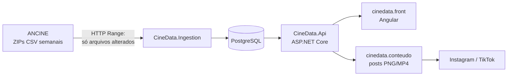

# CineData

**O cinema brasileiro em números.** Plataforma de dados e conteúdo (Instagram, TikTok) construída sobre os
[dados abertos da ANCINE/OCA](https://www.gov.br/ancine/pt-br/oca/dados-abertos).

> Status: **POC/MVP** — ingestão de uma amostra (8 semanas), API de métricas e painel web funcionando ponta a ponta.

| Painel da semana | Curva de público | Post gerado com dados reais |
| --- | --- | --- |
| Top 10, KPIs, nacional × estrangeiro, dublado × legendado, mapa por UF | Público diário por obra, dias parciais tracejados | Carrossel 1080×1350 (prévia em `/marca`) |

## Como o fluxo funciona



1. **Ingestão** lê o índice do ZIP da ANCINE via HTTP Range (sem baixar 1,2 GB), compara o CRC32 de cada CSV semanal
   com a última carga e importa só o que mudou. 605 mil sessões entram em ~15 s; a segunda execução leva 0,3 s.
2. **API** expõe métricas prontas (`/api/v1/painel`, `/ranking`, `/ufs`, `/periodos`, `/obras/{codigo}/curva`), por semana, mês, trimestre, semestre ou ano (`?periodo=mes`).
3. **Front** consome a API: painel com filtro de período, página de obra e a identidade visual com prévia de post.
4. **Conteúdo** (próxima etapa) renderiza os mesmos dados em templates de post.

## Rodando local

Pré-requisitos: .NET 10 SDK, Node 22+, Docker.

```bash
docker compose up -d                                              # PostgreSQL 17
cd cinedata.back
dotnet run --project src/CineData.Ingestion -- amostra 8          # migra o banco + 8 semanas + salas + lançamentos
dotnet run --project src/CineData.Api --launch-profile http       # http://localhost:5232 (docs em /scalar)
cd ../cinedata.front && npm install && npx ng serve --port 4300   # http://localhost:4300
```

Comandos da ingestão: `amostra [semanas]`, `bilheteria [semanas]` (sem número = histórico desde 2014: ~20 min, 38 milhões de sessões, 5 GB),
`cadastros`, `migrar`, `exportar <pasta> [desde]` (JSON do site estático).

Site público estático (sem banco online): `scripts/publicar-semana.sh` roda ingestão → `exportar` → build com
prerender; o workflow `Publicar site` publica no GitHub Pages ou Cloudflare Pages. Ver [docs/publicacao.md](docs/publicacao.md).

Testes: `dotnet test` em `cinedata.back` (117 testes) e `npx ng test --watch=false` em `cinedata.front` (20 testes).

## Estrutura

```
cinedata/
├── cinedata.back/          .NET 10 — Clean Architecture + DDD
│   ├── src/CineData.Domain           entidades e regras (Obra, Sala, Sessao, SemanaCinematografica…)
│   ├── src/CineData.Application      casos de uso (ingestão, consultas) e portas (interfaces)
│   ├── src/CineData.Infrastructure   ZIP remoto, CSV, EF Core + COPY, leitura com Dapper
│   ├── src/CineData.Api              endpoints mínimos, ProblemDetails, OpenAPI/Scalar
│   ├── src/CineData.Ingestion        CLI de carga
│   └── tests/                        testes por camada (xUnit)
├── cinedata.front/         Angular 22 — signals, httpResource, gráficos em SVG próprio
├── cinedata.conteudo/      geração de posts (planejado)
└── docs/                   estudo, arquitetura, dados, identidade visual, ADRs, backlog
```

## Documentação

- [Estudo de viabilidade](docs/estudo-viabilidade.md)
- [Arquitetura](docs/arquitetura.md)
- [Dados da ANCINE: formato e achados](docs/dados-ancine.md)
- [Identidade visual](docs/identidade-visual.md)
- [Decisões (ADRs)](docs/adr/)
- [Backlog das próximas etapas](docs/backlog.md)

## Fonte e licença dos dados

Dados: ANCINE / Observatório Brasileiro do Cinema e do Audiovisual (OCA), sob Creative Commons Attribution.
Todo conteúdo publicado credita "Fonte: ANCINE/OCA".
