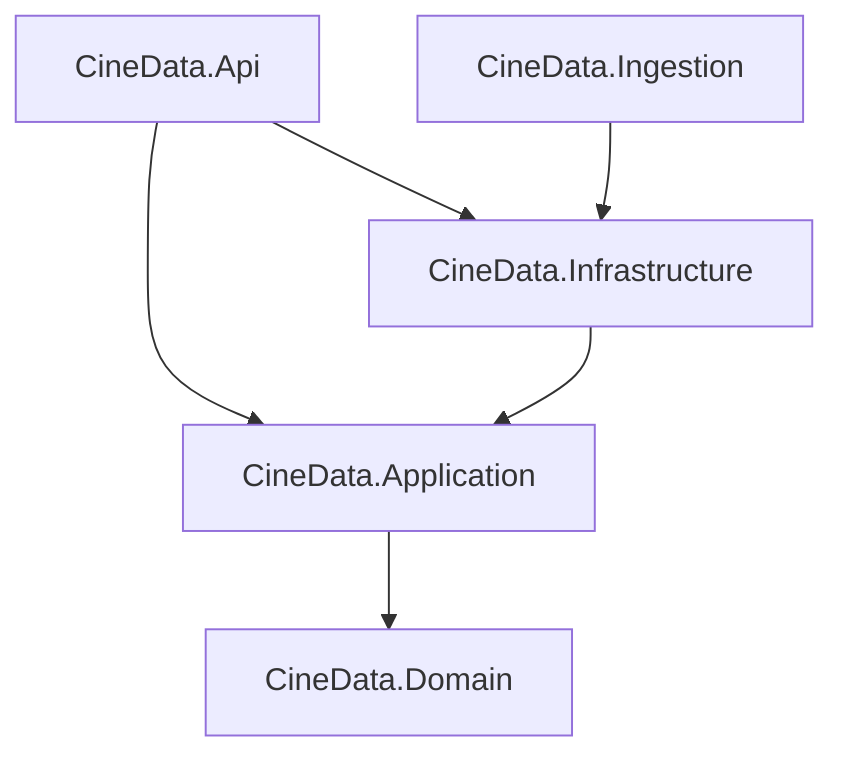

# Arquitetura

## Camadas (Clean Architecture)

As dependências apontam para dentro. O Domain não conhece banco, HTTP nem CSV.

| Camada | Responsabilidade | Exemplos |
| --- | --- | --- |
| **Domain** | Linguagem do negócio e invariantes | `CodigoObra` (CPB/ROE → origem), `SemanaCinematografica` (quinta a quarta), `Periodo` (semana, mês, trimestre, semestre, ano; anterior equivalente), `DiasConsolidados` (dia e período completos), `Uf` (com região), `Sessao`, `Sala`, `Lancamento`, `ArquivoImportado` (versão por CRC) |
| **Application** | Casos de uso e portas | `ImportarBilheteria` (incremental por CRC), `ImportarCadastros`, `ServicoConsultas` (período padrão por granularidade, completude, validações), `CoberturaPeriodos`; interfaces `IFonteDadosAncine`, `ILeitorCsvAncine`, `IRepositorio*`, `IConsultasBilheteria` |
| **Infrastructure** | Adaptadores | `ZipRemoto` (HTTP Range), `LeitorCsvAncine` (CsvHelper), `CineDataDbContext` (EF Core + snake_case), upserts com `unnest`, `COPY` binário, `ConsultasBilheteriaSql` (Dapper) |
| **Api** | Entrega HTTP | Minimal APIs em `/api/v1` (`periodo=semana\|mes\|trimestre\|semestre\|ano` + `data` em `/painel`, `/ranking`, `/ufs`; lista em `/periodos`), `ProblemDetails` para 400/404, OpenAPI + Scalar em `/scalar` |
| **Ingestion** | Entrega CLI | `amostra`, `bilheteria`, `cadastros`, `migrar` |

## Escrita × leitura (CQRS leve)

- **Escrita** passa pelo domínio: cada linha do CSV vira `Obra`, `Sala` e `Sessao` validadas. Linhas inválidas são
  contadas em `ArquivoImportado.LinhasRejeitadas`, não derrubam a carga.
- **Gravação em lote:** dimensões via `INSERT … SELECT unnest(…) ON CONFLICT`, fatos via `COPY` binário do Npgsql,
  tudo numa transação por arquivo. Recarregar um arquivo apaga e regrava as sessões dele (idempotente).
- **Leitura** não materializa entidades: SQL com Dapper direto para DTOs, sobre agregados de leitura.
- **Agregados** (`agregado_dia`, `agregado_semana`, `agregado_semana_obra`, `agregado_semana_uf`): tabelas criadas
  por migration e mantidas pela função `atualizar_agregados_bilheteria(inicio, fim)`, que recalcula as semanas
  cinematográficas inteiras do período. Cada arquivo importado registra em `agregado_pendente`, na mesma transação,
  as datas que tinha e as que tem agora; ao fim da carga os períodos são juntados e recalculados uma vez (uma carga
  interrompida deixa pendências que a próxima processa). O cadastro de salas recalcula o histórico (UF, município e
  assentos entram nos agregados). O painel não varre `sessoes`; só a curva de uma obra lê o fato direto (por índice).
- **Períodos de calendário** ([ADR 0005](adr/0005-periodos-de-calendario.md)): `agregado_calendario*` guarda mês,
  trimestre, semestre e ano, recortados pela data de exibição (a semana cinematográfica atravessa meses). Contagens
  distintas (salas, obras, municípios, salas por filme) não somam entre semanas nem entre meses, então
  `atualizar_agregados_calendario` recalcula anos inteiros a partir de uma base temporária mês × obra × sala.
  `atualizar_agregados_bilheteria` chama a semanal (`atualizar_agregados_semana`) e a de calendário. As views
  `agregado_periodo*` juntam as duas famílias e o SQL de leitura (`ConsultasBilheteriaSql`) é o mesmo para todas as
  granularidades.
- **Dias consolidados** são regra de domínio (`DiasConsolidados`), aplicada em memória sobre `agregado_dia` pelo
  `ServicoConsultas`: marca semanas (7 dias consolidados) e períodos de calendário (cobertos e com o fim consolidado)
  completos, e escolhe o período padrão de cada granularidade.

## Modelo de dados

| Tabela | Chave | Observação |
| --- | --- | --- |
| `obras` | `codigo` (CPB/ROE) | título original, título no Brasil, país |
| `salas` | `registro` | complexo, município, UF, exibidor, assentos (do cadastro de salas) |
| `sessoes` | `id` | fato: obra, sala, data, início, público, áudio, legenda, `arquivo_id` |
| `lancamentos` | `id` | público e renda totais por distribuidora (única fonte de R$) |
| `arquivos_importados` | `id` (único por fonte + nome) | CRC32, tamanho, linhas, rejeitadas |
| `agregado_dia` | `data` | salas que reportaram, sessões, público (base dos dias consolidados) |
| `agregado_semana` | `semana` (quinta) | público, sessões, obras, salas e municípios distintos |
| `agregado_semana_obra` | `semana`, `codigo_obra` | público, sessões, salas, assentos (ocupação), público dublado/original |
| `agregado_semana_uf` | `semana`, `uf` | público, sessões, público estrangeiro e dublado, obra líder |
| `agregado_calendario` | `granularidade`, `inicio` | mês, trimestre, semestre e ano: mesmas colunas de `agregado_semana` |
| `agregado_calendario_obra` | `granularidade`, `inicio`, `codigo_obra` | mesmas colunas de `agregado_semana_obra` |
| `agregado_calendario_uf` | `granularidade`, `inicio`, `uf` | mesmas colunas de `agregado_semana_uf` |
| `agregado_periodo*` (views) | `granularidade`, `inicio` | `UNION ALL` de semana (`granularidade = 'semana'`) e calendário |
| `agregado_pendente` | `id` | períodos importados ainda não recalculados nos agregados |

## Front

Angular 22 standalone, sem zone.js, `httpResource` + signals, rotas com lazy loading e `withComponentInputBinding`.
Gráficos em SVG/CSS próprios (sem biblioteca), seguindo a paleta validada da [identidade visual](identidade-visual.md).
Em desenvolvimento o `ng serve` faz proxy de `/api` para `localhost:5232` (`proxy.conf.json`).
O painel lê granularidade e período da URL (`/?periodo=trimestre&data=2025-07-01`, via `withComponentInputBinding`);
sem `data`, mostra o último período completo. Rótulos curtos vêm da API ("out/2026", "3º tri 2025", "1º sem 2026");
títulos e textos por granularidade ficam em `shared/periodo.ts`. Em período parcial o front não mostra variação.
