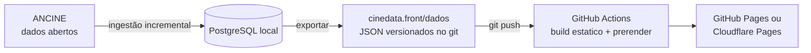

# Publicação do site estático

O site público do CineData é **estático**: o banco fica na máquina local, a CLI exporta os mesmos dados da API em
JSON, o Angular pré-renderiza uma página HTML por semana, mês, trimestre, semestre, ano e obra, e qualquer host
estático serve o resultado. Não há servidor nem banco online.



## Toda semana (passo a passo)

Depois que a ANCINE publica os dados novos (em geral no começo da semana):

```bash
scripts/publicar-semana.sh --enviar
```

O script faz, em ordem:

1. `docker compose -p cinedata up -d --wait` — o PostgreSQL local (o mesmo volume da pasta principal).
2. `dotnet run --project src/CineData.Ingestion -- bilheteria` — ingestão incremental: só baixa os CSVs cujo CRC32
   mudou e recalcula os agregados tocados. `--cadastros` também reimporta salas e lançamentos.
3. `dotnet run --project src/CineData.Ingestion -- posteres` — liga ao TMDB só os filmes que entraram agora nos
   rankings (pôster). Precisa do token: `dotnet user-secrets set Tmdb:Token <token> --project src/CineData.Ingestion`.
4. `dotnet run --project src/CineData.Ingestion -- exportar ../cinedata.front/dados` — os JSON do site.
5. `npm run build:estatico` em `cinedata.front` — prerender de todas as páginas em `dist/site/browser`.
6. Com `--enviar`: commit de `cinedata.front/dados` ("Dados: bilheteria até AAAA-MM-DD") e `git push`. O push na
   `main` dispara o workflow [Publicar site](../.github/workflows/publicar-site.yml), que gera o site de novo no
   GitHub Actions e publica.

Sem `--enviar` o script para antes do commit, para conferir o site local:

```bash
node cinedata.front/scripts/servir-estatico.mjs   # http://localhost:4320, com 404 como no host
```

Outras opções: `--sem-ingestao` (só exporta e gera o site com o que já está no banco).

### Medições (dados até 22/10/2026, histórico completo no banco)

| Etapa | Tempo | Volume |
| --- | --- | --- |
| `exportar` | 15–20 s | 2.318 JSON, 19,5 MB: 727 períodos desde ago/2016, 1.444 obras, séries dos 27 estados |
| `build:estatico` | ~10 s | 2.911 páginas pré-renderizadas (painel e mapa de cada período, obras), 5.248 arquivos, 215 MB |
| Página típica | — | 40–90 KB de HTML (~15 KB com gzip), com os dados embutidos: o navegador não busca o JSON de novo |

Folga nos limites dos hosts gratuitos: Cloudflare Pages aceita até 20.000 arquivos por site (25 MB cada); GitHub
Pages recomenda até 1 GB por site.

## O que o export gera

`exportar <pasta> [desde AAAA-MM-DD]` (padrão desde 2016-08-01, quando a série fica representativa — achado 9 de
[dados-ancine.md](dados-ancine.md)) usa os mesmos casos de uso da API (`ServicoConsultas`), então período padrão,
completude, estreias e dias parciais seguem as mesmas regras ([ADR 0004](adr/0004-dias-consolidados.md) e
[ADR 0005](adr/0005-periodos-de-calendario.md)).

| Arquivo | Conteúdo | Equivale a |
| --- | --- | --- |
| `indice.json` | geração, dados até, último dia consolidado, por granularidade o período padrão, o primeiro e o último | — |
| `{g}/periodos.json` | períodos exportados da granularidade (`semana`, `mes`, `trimestre`, `semestre`, `ano`) | `/api/v1/periodos?periodo={g}` |
| `{g}/padrao.json` | último período completo (página `/mes`, `/ano`… e a home) | `/api/v1/painel?periodo={g}` |
| `{g}/{chave}.json` | painel do período: resumo, top 10, origem, áudio, UFs | `/api/v1/painel?periodo={g}&data=…` |
| `obras/{codigo}.json` | obra e curva diária, para cada obra de um top 10 ou líder de UF | `/api/v1/obras/{codigo}/curva` |
| `ufs/{UF}/{g}.json` | série do estado: público, parcela do Brasil, posição e filme líder em cada período | `/api/v1/ufs/{UF}/serie?periodo={g}` |
| `busca.json` | código, título, título original (se diferente), origem e público das obras com página | `/api/v1/obras?busca=` |

Chaves de período (arquivo e URL): semana `2026-10-08` (a quinta de início), mês `2026-09`, trimestre `2025-t3`,
semestre `2026-s1`, ano `2025`. A conversão existe no back (`ChavePeriodo`) e no front (`chavePeriodo` em
`shared/periodo.ts`), com os mesmos casos de teste nos dois lados.

O export grava numa pasta irmã (`dados.novo`) e só troca a pasta no fim: um export interrompido não deixa o site pela
metade, e obras ou períodos que saíram não ficam para trás. A pasta de destino precisa estar vazia ou ser um export
anterior (com `indice.json`); qualquer outra é recusada.

## Como o front lê os dados

- `src/environments/ambiente.ts` diz a fonte: `api` (desenvolvimento, `ng serve` com proxy para a API) ou `estatico`.
  O build `estatico` troca o arquivo por `ambiente.estatico.ts` (`fileReplacements`).
- `core/api/rotas-api.ts` tem dois conjuntos de URLs com a mesma interface (`rotasDaApi`, `rotasEstaticas`); os
  componentes não sabem de qual vêm os dados. No estático a busca recebe o índice inteiro e filtra no navegador.
- URLs por caminho em ambos os modos: `/`, `/semana/2026-10-08`, `/mes`, `/mes/2026-09`, `/trimestre/2025-t3`,
  `/semestre/2026-s1`, `/ano/2025`, `/mapa`, `/mapa/mes/2026-09?uf=PE`, `/obras/{codigo}`, `/sobre`. As antigas (`/?periodo=mes&data=…`) continuam na API.
- `app.routes.server.ts` lista as páginas para o prerender lendo `dados/{g}/periodos.json` e `dados/busca.json`.
  O estado escolhido no mapa (`?uf=`) não muda o HTML: a página do período é a mesma e o navegador abre o detalhe.
- Cada página define `<title>`, description, Open Graph, Twitter card e canonical (`shared/seo.ts`). A imagem de
  compartilhamento é `public/og-cinedata.png` (fonte em `docs/marca/og-cinedata.html`, sem imagens de filmes).
- Hidratação com transfer cache: o HTML já vem com os números e o navegador não refaz as requisições.
- `scripts/pos-build-estatico.mjs` troca o marcador `%URL_SITE%` pelo endereço público, cria `404.html`, `sitemap.xml`
  e `robots.txt`.

## O que você precisa ativar (uma vez)

Nada foi criado em serviço externo. Escolha um destino:

### Opção A — Cloudflare Pages (recomendada para repositório privado, gratuita)

1. Crie uma conta no Cloudflare e um projeto Pages do tipo **Direct Upload** chamado, por exemplo, `cinedata`
   (Workers & Pages → Create → Pages → Upload assets; pode subir qualquer pasta só para criar o projeto).
2. Crie um API token com a permissão **Cloudflare Pages: Edit** e copie o Account ID.
3. No GitHub (Settings → Secrets and variables → Actions):
   - Secrets: `CLOUDFLARE_API_TOKEN`, `CLOUDFLARE_ACCOUNT_ID`.
   - Variables: `DESTINO_SITE=cloudflare`, `CLOUDFLARE_PROJETO=cinedata`, `URL_SITE=https://cinedata.pages.dev`
     (ou o domínio próprio, depois de ligá-lo em Custom domains).
4. Rode o workflow **Publicar site** (Actions → Run workflow) ou faça um push na `main`.

### Opção B — GitHub Pages

GitHub Pages em repositório **privado** exige plano pago (Pro, Team ou Enterprise); no plano gratuito só funciona
com o repositório público.

1. Settings → Pages → Source: **GitHub Actions**.
2. Variables: `DESTINO_SITE=github-pages` e `URL_SITE=https://<usuario>.github.io/<repositorio>`.
   Sem domínio próprio o site fica numa subpasta: defina também `BASE_HREF=/<repositorio>/`. Com domínio próprio
   (Settings → Pages → Custom domain), `URL_SITE=https://seu-dominio` e sem `BASE_HREF`.
3. Rode o workflow **Publicar site**.

#### Domínio próprio no GitHub Pages

O deploy é por GitHub Actions, então **não precisa de arquivo `CNAME`** no site: o domínio fica nas configurações.

1. **Verificar o domínio na conta** (protege contra outra conta usar o domínio): avatar → Settings → Pages → Add a
   domain. O GitHub mostra um registro TXT (`_github-pages-challenge-<usuario>`) para criar no DNS; depois, Verify.
2. **DNS** (no Registro.br: Editar zona; ou no provedor de DNS que você usa):
   - Domínio raiz (`seudominio.com.br`): quatro registros **A** — `185.199.108.153`, `185.199.109.153`,
     `185.199.110.153`, `185.199.111.153` — e, para IPv6, quatro **AAAA** — `2606:50c0:8000::153`,
     `2606:50c0:8001::153`, `2606:50c0:8002::153`, `2606:50c0:8003::153`.
   - `www`: um **CNAME** apontando para `<usuario>.github.io` (sem o nome do repositório).
   - Apague registros A/AAAA/CNAME antigos do mesmo nome (página de estacionamento do registrador).
3. **No repositório:** Settings → Pages → Custom domain → `seudominio.com.br` → Save. O GitHub checa o DNS
   (a propagação leva de minutos a algumas horas).
4. Quando o certificado sair (até ~24 h), marque **Enforce HTTPS**.
5. **Variáveis do workflow:** `URL_SITE=https://seudominio.com.br` e **remova `BASE_HREF`** (com domínio próprio o
   site fica na raiz). Rode o workflow **Publicar site** de novo para as páginas saírem com o endereço certo
   (og:url, canonical, sitemap).

Para conferir o DNS: `dig seudominio.com.br +short` deve listar os quatro IPs `185.199.x.153`, e
`dig www.seudominio.com.br +short` deve mostrar `<usuario>.github.io`.

Sem `DESTINO_SITE` o workflow só gera o site e guarda como artefato por 7 dias (útil para conferir).

## Pôsteres (TMDB)

Cada filme do site é ligado a um filme do [TMDB](https://www.themoviedb.org/) pelo título original e pelo ano
(`CorrespondenciaTmdb`): o título original ou o título no Brasil precisa bater (sem acento, pontuação nem "e/and") e
o ano não pode ser depois do lançamento no Brasil; festival até 3 anos antes passa; clássico relançado (Carros em 2026)
só com o título original exato e o filme conhecido no TMDB. Resultado em `obras_tmdb` (1.399 de 1.439 filmes na
primeira carga, 81 s).

**As imagens vão junto com o site.** No pós-build (`scripts/posteres-estaticos.mjs`), os pôsteres citados nos JSON são
copiados para `posteres/<largura>/<arquivo>` nas três larguras da tela (w92, w185, w342): 1.387 pôsteres, 79 MB, ~1 min
na primeira vez. O visitante não acessa o TMDB, a página não depende dele estar no ar e as imagens saem do mesmo
domínio. Só o `og:image` da página do filme (w780) continua apontando para o TMDB, porque precisa de endereço absoluto e
só é lido pelos robôs do WhatsApp e do Instagram.

- Cache: os arquivos baixados ficam em `cinedata.front/.cache/posteres` (fora do git); cada build só baixa os filmes
  novos. No GitHub Actions o cache tem a chave do semestre (`posteres-2026-s2-…`): os termos do TMDB permitem guardar o
  conteúdo por até seis meses, então a cada semestre tudo é baixado de novo.
- Pôster que não baixar fica de fora com aviso no log; no site, o `cd-cartaz` mostra o cartaz tipográfico quando a
  imagem não carrega. `SEM_POSTERES=1` pula a etapa.
- No desenvolvimento (`ng serve` com a API), as imagens continuam vindo de `image.tmdb.org`.

- Correção à mão (cadastro ambíguo na ANCINE): `posteres definir <codigo> <tmdb_id>` ou `posteres definir <codigo>
  nenhum`. A busca automática não mexe mais nessas obras. Já corrigidos: TWILIGHT (E1600635500000) → Crepúsculo (8966);
  HOMEM ARANHA (B0500409500000) sem pôster.
- Sem correspondência, a obra é buscada de novo depois de 30 dias; no site aparece um cartaz tipográfico (iniciais).
- Termos: o uso gratuito da API do TMDB é para projetos não comerciais e exige o crédito ("Este produto usa a API do
  TMDB, mas não é endossado nem certificado pelo TMDB"), que está em Como medimos e no rodapé. **Antes de cobrar pelo
  acesso, falar com o TMDB sobre licença comercial.**

## Acessos (Umami)

O site conta visitas com o [Umami Cloud](https://umami.is): sem cookies (dispensa banner de consentimento) e sem
guardar IP; a página `/sobre` avisa o leitor. O script só entra no site publicado, e só com a variável `UMAMI_ID`.

**Ativar (uma vez):**
1. Crie a conta em https://cloud.umami.is → **Add website** → nome `CineData`, domínio `cinedatabr.tech`.
2. Copie o **Website ID** (Settings do site no Umami; um UUID).
3. No GitHub: Settings → Secrets and variables → Actions → **Variables** → `UMAMI_ID` = o UUID.
4. Rode o workflow **Publicar site**. O script vai em todas as páginas, com `data-domains="cinedatabr.tech"`
   (acessos de teste em localhost não contam).

**O que aparece no painel:** visitantes, páginas, de onde vieram (referrer e UTM), país, dispositivo e os eventos:

| Evento | Quando | Dados |
| --- | --- | --- |
| `mapa-estado` | clique num estado | `uf`, `origem` (mapa, lista, vizinho, podio) |
| `mapa-metrica` | troca do que o mapa mostra | `metrica` |
| `filme-aberto` | clique num filme | `filme` (código), `origem` (top10, numero-1, mes, mapa-estado, mapa-vencedores) |
| `busca` | resultado escolhido na busca | `termo`, `filme` |
| `abrir-mapa`, `instagram`, `fonte-ancine` | cliques nesses links | — |
| `trailer` | play no trailer de uma matéria | — |
| `obra-vizinha`, `materia-obra` | clique num filme do bloco "Na mesma semana" ou de uma matéria | — |

Os eventos ficam em atributos `data-umami-event` no HTML dos componentes. Para medir o Instagram, use na bio
`https://cinedatabr.tech/?utm_source=instagram&utm_medium=bio` (e `utm_medium=story` / `post` nos outros links): o
Umami separa as visitas por campanha. Cada post aponta para a sua matéria:
`https://cinedatabr.tech/materias/<slug>?utm_source=instagram&utm_medium=post&utm_campaign=<slug>`.

## Buscadores (SEO)

O que o build já entrega: uma página HTML pré-renderizada por período, mapa, filme e matéria, com título, descrição,
Open Graph, canonical e dados estruturados (schema.org em JSON-LD: `Organization`, `WebSite`, `Dataset` nos
períodos, `Movie` + `BreadcrumbList` nos filmes, `NewsArticle` (com `articleSection` = formato) nas matérias e
`CollectionPage` + `ItemList` na página de Notícias, `/materias`). O pós-build:

- **achata as páginas** (`obras/X/index.html` → `obras/X.html`): o host serve `/obras/X` com 200, sem redirecionar
  para `/obras/X/`, então endereço servido, canonical, sitemap e links internos são o mesmo;
- gera o **sitemap** só com páginas cujo canonical é o próprio endereço (aliases como `/semana` e `/mapa/mes` ficam de
  fora) e com `lastmod` real: um período antigo fica com a data em que se consolidou, os filmes em cartaz e as páginas
  atuais com a data dos dados, as matérias com a data delas.

**Ativar (uma vez), Google Search Console:**
1. https://search.google.com/search-console → **Adicionar propriedade** → **Domínio** → `cinedatabr.tech`.
2. O Google mostra um registro **TXT** (`google-site-verification=…`). Crie esse TXT no DNS do domínio (no painel
   onde o `cinedatabr.tech` foi registrado) e clique em **Verificar** (pode levar alguns minutos).
3. **Sitemaps** → enviar `https://cinedatabr.tech/sitemap.xml`.
4. **Inspeção de URL** → cole `https://cinedatabr.tech/` e uma matéria → **Solicitar indexação** (acelera a primeira
  visita do robô).
5. Depois de 3–7 dias: **Páginas** (o que foi indexado e por que não) e **Desempenho** (buscas que trazem gente).

**Bing Webmaster Tools** (também alimenta DuckDuckGo e o ChatGPT search): https://www.bing.com/webmasters →
**Importar do Google Search Console** (usa a verificação acima).

**Conferir depois de publicar:**

```bash
curl -sI https://cinedatabr.tech/obras/E2600183000000 | head -3   # 200, sem "location"
```

e o [Rich Results Test](https://search.google.com/test/rich-results) numa página de filme e numa matéria.

## Opção futura: tudo no GitHub Actions, com PostgreSQL temporário

Hoje a ingestão roda na máquina local porque o banco tem o histórico inteiro (5,1 GB) e a ingestão é incremental.
Para não depender da máquina, um workflow agendado pode montar um banco descartável a cada execução:

```yaml
on:
  schedule: [{ cron: '0 9 * * 2' }]   # terças, 06:00 em Brasília
jobs:
  semana:
    runs-on: ubuntu-latest
    timeout-minutes: 60
    services:
      postgres:
        image: postgres:17-alpine
        env: { POSTGRES_DB: cinedata, POSTGRES_USER: cinedata, POSTGRES_PASSWORD: cinedata }
        ports: ['5432:5432']
        options: --health-cmd "pg_isready -U cinedata" --health-interval 5s --health-retries 20
    steps:
      - uses: actions/checkout@v4
      - uses: actions/setup-dotnet@v4
        with: { dotnet-version: 10.0.x }
      - working-directory: cinedata.back
        run: |
          dotnet run --project src/CineData.Ingestion -- cadastros   # migra o banco vazio + salas e lançamentos
          dotnet run --project src/CineData.Ingestion -- bilheteria  # histórico completo: ~19 min
          dotnet run --project src/CineData.Ingestion -- exportar ../cinedata.front/dados
      # depois: commit de cinedata.front/dados (permissions: contents: write) ou build + deploy direto
```

Custos e cuidados:

- **Tempo:** ~19 min de carga completa (medido em 23/10/2026: 38,5 mi de sessões) + migrations + export + build,
  ~25–30 min por semana. Repositório privado no plano gratuito tem 2.000 min/mês de Actions: cabe (~130 min/mês).
- **Disco:** o runner tem ~14 GB livres; o banco ocupa 5,1 GB e o ZIP da ANCINE 1,2 GB.
- **Rede:** sem banco persistente a ingestão não é incremental: baixa o ZIP inteiro toda semana.
- Para encurtar, dá para guardar um `pg_dump` compactado como artefato/cache e restaurar antes da ingestão
  incremental (a carga cairia para poucos minutos, mas o dump tem ~1–2 GB).
