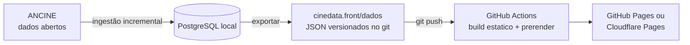

# Publicação do site estático

O site público do CineData é **estático**: o banco fica na máquina local, a CLI exporta os mesmos dados da API em
JSON, o Angular pré-renderiza uma página HTML por semana, mês, trimestre, semestre, ano e obra, e qualquer host
estático serve o resultado. Não há servidor nem banco online.



## Toda semana (passo a passo)

Depois que a ANCINE publica os dados novos (em geral no começo da semana):

```bash
scripts/publicar-semana.sh --enviar
```

O script faz, em ordem:

1. `docker compose -p cinedata up -d --wait` — o PostgreSQL local (o mesmo volume da pasta principal).
2. `dotnet run --project src/CineData.Ingestion -- bilheteria` — ingestão incremental: só baixa os CSVs cujo CRC32
   mudou e recalcula os agregados tocados. `--cadastros` também reimporta salas e lançamentos.
3. `dotnet run --project src/CineData.Ingestion -- exportar ../cinedata.front/dados` — os JSON do site.
4. `npm run build:estatico` em `cinedata.front` — prerender de todas as páginas em `dist/site/browser`.
5. Com `--enviar`: commit de `cinedata.front/dados` ("Dados: bilheteria até AAAA-MM-DD") e `git push`. O push na
   `main` dispara o workflow [Publicar site](../.github/workflows/publicar-site.yml), que gera o site de novo no
   GitHub Actions e publica.

Sem `--enviar` o script para antes do commit, para conferir o site local:

```bash
node cinedata.front/scripts/servir-estatico.mjs   # http://localhost:4320, com 404 como no host
```

Outras opções: `--sem-ingestao` (só exporta e gera o site com o que já está no banco).

### Medições (dados até 22/10/2026, histórico completo no banco)

| Etapa | Tempo | Volume |
| --- | --- | --- |
| `exportar` | 20 s | 2.183 JSON, 15,7 MB (2,4 MB compactado): 727 períodos desde ago/2016, 1.444 obras |
| `build:estatico` | 8 s | 2.178 páginas pré-renderizadas, 4.378 arquivos, 148 MB |
| Página típica | — | 40–90 KB de HTML (~15 KB com gzip), com os dados embutidos: o navegador não busca o JSON de novo |

Folga nos limites dos hosts gratuitos: Cloudflare Pages aceita até 20.000 arquivos por site (25 MB cada); GitHub
Pages recomenda até 1 GB por site.

## O que o export gera

`exportar <pasta> [desde AAAA-MM-DD]` (padrão desde 2016-08-01, quando a série fica representativa — achado 9 de
[dados-ancine.md](dados-ancine.md)) usa os mesmos casos de uso da API (`ServicoConsultas`), então período padrão,
completude, estreias e dias parciais seguem as mesmas regras ([ADR 0004](adr/0004-dias-consolidados.md) e
[ADR 0005](adr/0005-periodos-de-calendario.md)).

| Arquivo | Conteúdo | Equivale a |
| --- | --- | --- |
| `indice.json` | geração, dados até, último dia consolidado, por granularidade o período padrão, o primeiro e o último | — |
| `{g}/periodos.json` | períodos exportados da granularidade (`semana`, `mes`, `trimestre`, `semestre`, `ano`) | `/api/v1/periodos?periodo={g}` |
| `{g}/padrao.json` | último período completo (página `/mes`, `/ano`… e a home) | `/api/v1/painel?periodo={g}` |
| `{g}/{chave}.json` | painel do período: resumo, top 10, origem, áudio, UFs | `/api/v1/painel?periodo={g}&data=…` |
| `obras/{codigo}.json` | obra e curva diária, para cada obra de um top 10 ou líder de UF | `/api/v1/obras/{codigo}/curva` |
| `busca.json` | código, título, título original (se diferente), origem e público das obras com página | `/api/v1/obras?busca=` |

Chaves de período (arquivo e URL): semana `2026-10-08` (a quinta de início), mês `2026-09`, trimestre `2025-t3`,
semestre `2026-s1`, ano `2025`. A conversão existe no back (`ChavePeriodo`) e no front (`chavePeriodo` em
`shared/periodo.ts`), com os mesmos casos de teste nos dois lados.

O export grava numa pasta irmã (`dados.novo`) e só troca a pasta no fim: um export interrompido não deixa o site pela
metade, e obras ou períodos que saíram não ficam para trás. A pasta de destino precisa estar vazia ou ser um export
anterior (com `indice.json`); qualquer outra é recusada.

## Como o front lê os dados

- `src/environments/ambiente.ts` diz a fonte: `api` (desenvolvimento, `ng serve` com proxy para a API) ou `estatico`.
  O build `estatico` troca o arquivo por `ambiente.estatico.ts` (`fileReplacements`).
- `core/api/rotas-api.ts` tem dois conjuntos de URLs com a mesma interface (`rotasDaApi`, `rotasEstaticas`); os
  componentes não sabem de qual vêm os dados. No estático a busca recebe o índice inteiro e filtra no navegador.
- URLs por caminho em ambos os modos: `/`, `/semana/2026-10-08`, `/mes`, `/mes/2026-09`, `/trimestre/2025-t3`,
  `/semestre/2026-s1`, `/ano/2025`, `/obras/{codigo}`, `/sobre`. As antigas (`/?periodo=mes&data=…`) continuam na API.
- `app.routes.server.ts` lista as páginas para o prerender lendo `dados/{g}/periodos.json` e `dados/busca.json`.
- Cada página define `<title>`, description, Open Graph, Twitter card e canonical (`shared/seo.ts`). A imagem de
  compartilhamento é `public/og-cinedata.png` (fonte em `docs/marca/og-cinedata.html`, sem imagens de filmes).
- Hidratação com transfer cache: o HTML já vem com os números e o navegador não refaz as requisições.
- `scripts/pos-build-estatico.mjs` troca o marcador `%URL_SITE%` pelo endereço público, cria `404.html`, `sitemap.xml`
  e `robots.txt`.

## O que você precisa ativar (uma vez)

Nada foi criado em serviço externo. Escolha um destino:

### Opção A — Cloudflare Pages (recomendada para repositório privado, gratuita)

1. Crie uma conta no Cloudflare e um projeto Pages do tipo **Direct Upload** chamado, por exemplo, `cinedata`
   (Workers & Pages → Create → Pages → Upload assets; pode subir qualquer pasta só para criar o projeto).
2. Crie um API token com a permissão **Cloudflare Pages: Edit** e copie o Account ID.
3. No GitHub (Settings → Secrets and variables → Actions):
   - Secrets: `CLOUDFLARE_API_TOKEN`, `CLOUDFLARE_ACCOUNT_ID`.
   - Variables: `DESTINO_SITE=cloudflare`, `CLOUDFLARE_PROJETO=cinedata`, `URL_SITE=https://cinedata.pages.dev`
     (ou o domínio próprio, depois de ligá-lo em Custom domains).
4. Rode o workflow **Publicar site** (Actions → Run workflow) ou faça um push na `main`.

### Opção B — GitHub Pages

GitHub Pages em repositório **privado** exige plano pago (Pro, Team ou Enterprise); no plano gratuito só funciona
com o repositório público.

1. Settings → Pages → Source: **GitHub Actions**.
2. Variables: `DESTINO_SITE=github-pages` e `URL_SITE=https://<usuario>.github.io/<repositorio>`.
   Sem domínio próprio o site fica numa subpasta: defina também `BASE_HREF=/<repositorio>/`. Com domínio próprio
   (Settings → Pages → Custom domain), `URL_SITE=https://seu-dominio` e sem `BASE_HREF`.
3. Rode o workflow **Publicar site**.

Sem `DESTINO_SITE` o workflow só gera o site e guarda como artefato por 7 dias (útil para conferir).

## Opção futura: tudo no GitHub Actions, com PostgreSQL temporário

Hoje a ingestão roda na máquina local porque o banco tem o histórico inteiro (5,1 GB) e a ingestão é incremental.
Para não depender da máquina, um workflow agendado pode montar um banco descartável a cada execução:

```yaml
on:
  schedule: [{ cron: '0 9 * * 2' }]   # terças, 06:00 em Brasília
jobs:
  semana:
    runs-on: ubuntu-latest
    timeout-minutes: 60
    services:
      postgres:
        image: postgres:17-alpine
        env: { POSTGRES_DB: cinedata, POSTGRES_USER: cinedata, POSTGRES_PASSWORD: cinedata }
        ports: ['5432:5432']
        options: --health-cmd "pg_isready -U cinedata" --health-interval 5s --health-retries 20
    steps:
      - uses: actions/checkout@v4
      - uses: actions/setup-dotnet@v4
        with: { dotnet-version: 10.0.x }
      - working-directory: cinedata.back
        run: |
          dotnet run --project src/CineData.Ingestion -- cadastros   # migra o banco vazio + salas e lançamentos
          dotnet run --project src/CineData.Ingestion -- bilheteria  # histórico completo: ~19 min
          dotnet run --project src/CineData.Ingestion -- exportar ../cinedata.front/dados
      # depois: commit de cinedata.front/dados (permissions: contents: write) ou build + deploy direto
```

Custos e cuidados:

- **Tempo:** ~19 min de carga completa (medido em 23/10/2026: 38,5 mi de sessões) + migrations + export + build,
  ~25–30 min por semana. Repositório privado no plano gratuito tem 2.000 min/mês de Actions: cabe (~130 min/mês).
- **Disco:** o runner tem ~14 GB livres; o banco ocupa 5,1 GB e o ZIP da ANCINE 1,2 GB.
- **Rede:** sem banco persistente a ingestão não é incremental: baixa o ZIP inteiro toda semana.
- Para encurtar, dá para guardar um `pg_dump` compactado como artefato/cache e restaurar antes da ingestão
  incremental (a carga cairia para poucos minutos, mas o dump tem ~1–2 GB).
